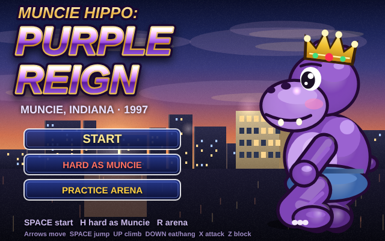
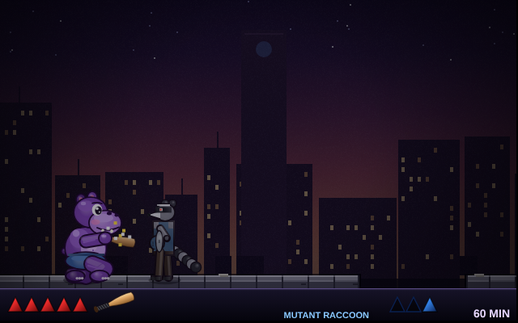
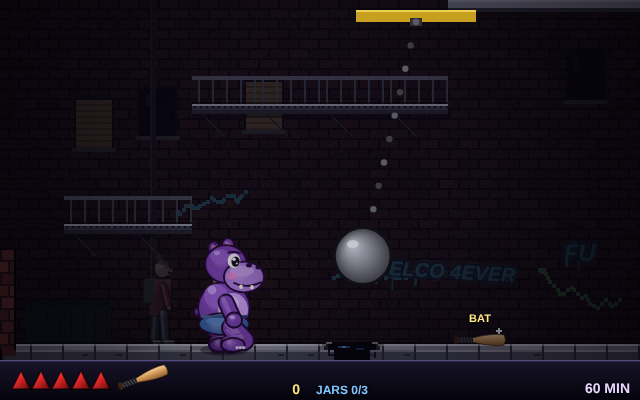
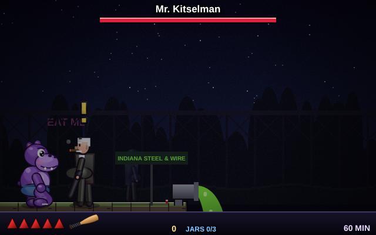
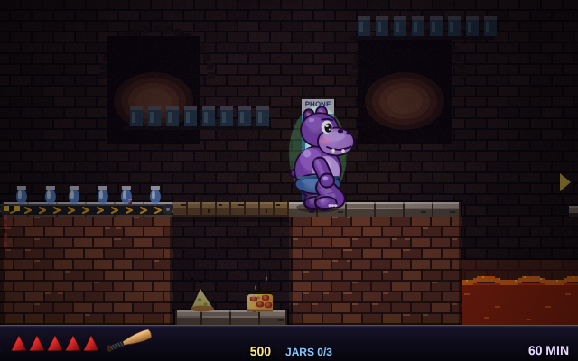
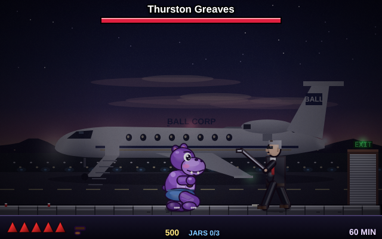
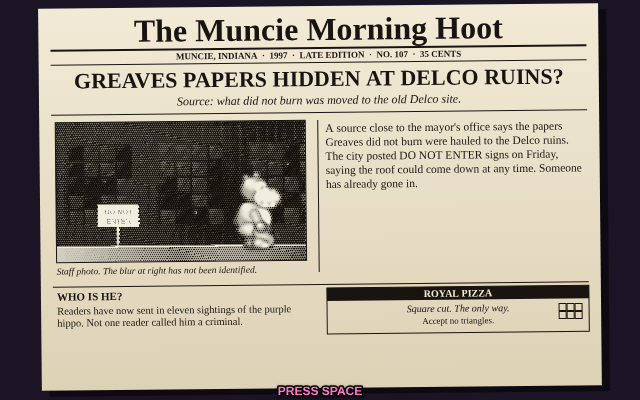

# Muncie Hippo: Purple Reign

A browser game inspired by the early-1990s Mac version of Prince of Persia. It's 1997 in deindustrialized Muncie, Indiana. Ball Corporation is packing up for Colorado, slick executive Thurston Greaves and crooked Mayor Buck Dimsdale are greasing the deal, and one purple hippo has 60 minutes to do something about it.

**Play it:** https://andyshearsphd.github.io/Purple-Reign/ (or open `index.html` in any modern browser).

## Screenshots

| | |
|---|---|
|  |  |
| Fighting a mutant raccoon downtown | Ducking a wrecking ball downtown |
|  |  |
| Mr. Kitselman and the Indiana Steel and Wire outflow pipe | Conveyor belts and molten glass at the glass works |
|  |  |
| Showdown with Thurston Greaves at the airport | The Muncie Morning Hoot between levels |

## Controls

**Keyboard**
- Arrow keys: move (tap for one careful step)
- Space: jump
- Up: climb, or go through a door
- Down: eat, crouch, hang off an edge, or put your weapon away
- X: attack
- Z: block (hold)
- 1 to 3, or Q: switch weapons (knife, bat, whip)
- P or Esc: pause
- M: mute

**Phone:** an on-screen d-pad with JUMP, ATTACK, BLOCK and SWAP buttons appears automatically.

## Features

- 12 levels across Muncie, from the rail yards and sewers to Ball Corp headquarters, City Hall and the county airport
- Royal Pizza square slices heal, whole pizzas restore health, extra-large boxes raise max health, and triangle slices hurt
- Mutant geese, muskrats, squirrels, raccoons, pit bulls and alley cats, plus rednecks, slumlords, businessmen, politicians, crooked cops and airport security
- Bosses: Mr. Kitselman of Indiana Steel and Wire, Mayor Buck Dimsdale and Thurston Greaves, plus your own shadow
- Set pieces, chases, hidden Ball jars, payphone checkpoints, scores and ranks
- A newspaper front page between levels that tells the story
- Normal mode, plus a "Hard as Muncie" mode

## Notes

Everything is in one self-contained HTML file with no dependencies. Graphics and music are generated in code.

Thurston Greaves, Buck Dimsdale and The Muncie Morning Hoot are fictional.
